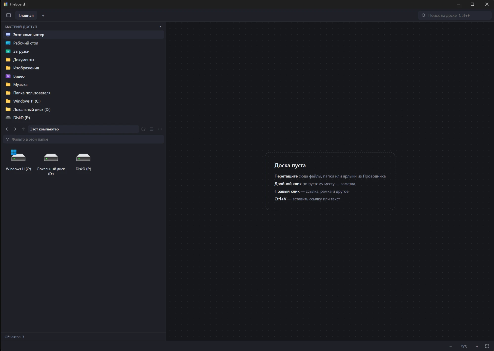

# FileBoard

**Все нужные папки, файлы и ссылки — на одной доске.** Перетащил, разложил как удобно, открываешь одним кликом.

Хватит искать одну и ту же папку через пять уровней Проводника или держать рабочий стол, заваленный ярлыками. В FileBoard вы раскладываете всё, с чем работаете, на свободной доске — как стикеры на стене: проекты в одном углу, документы в другом, рядом ссылки на сайты и заметки. Можно завести несколько досок: «Работа», «Учёба», «Игры».

Слева — встроенный проводник: находите нужное и перетаскиваете на доску, а заодно копируете, переименовываете и распаковываете архивы, не открывая лишних окон.

Программа лёгкая: установщик весит около 1 МБ и почти не нагружает компьютер.



## Возможности

**Доска**
- Несколько досок вкладками, бесконечное поле, масштаб колёсиком
- Карточки файлов и папок с настоящими иконками Windows и превью картинок
- Ссылки на сайты, заметки, рамки для группировки
- Двойной клик — открыть; «Показать в папке»; «Открыть с помощью…»
- Перетаскивание карточки за край окна — файл уходит в другую программу (Telegram, браузер…)
- Отмена/повтор (Ctrl+Z / Ctrl+Y), поиск по доске (Ctrl+F)
- Если файл переместили или удалили — карточка помечается «!»

**Панель-проводник слева** (Ctrl+B)
- Быстрый доступ: Рабочий стол, Загрузки, Документы, диски
- Вид списком или крупными значками с превью
- Перетаскивание на доску, в папки, в другие программы
- Копировать / вырезать / вставить (совместимо с Проводником), переименовать (F2), новая папка (Ctrl+Shift+N)
- Удаление — только в Корзину и только после подтверждения
- Архивы: упаковать в RAR/ZIP и распаковать через WinRAR; без WinRAR — встроенным в Windows архиватором (ZIP)

## Установка

1. Скачайте `FileBoard_x.x.x_x64-setup.exe` из раздела [Releases](../../releases).
2. Запустите. Программа не подписана платным сертификатом, поэтому Windows может показать окно «Система Windows защитила ваш компьютер» — нажмите **«Подробнее» → «Выполнить в любом случае»**.

Нужна Windows 10 или 11 (64-бит).

Доски хранятся в `%APPDATA%\com.fileboard.app\boards.json` (рядом — резервная копия `.bak`).

## Безопасность ваших файлов

- Карточки на доске — только ссылки: удаление карточки не трогает сам файл.
- Удаление файлов — только в Корзину, с подтверждением.
- Копирование, перемещение и удаление выполняет сама Windows (тот же механизм, что в Проводнике), с обычными вопросами о замене.
- Программа не отправляет никаких данных в интернет.

## Для разработчиков

Сделано на [Tauri 2](https://tauri.app) (Rust + системный WebView2) — поэтому ~80 МБ памяти в работе, а не сотни, как у программ на Electron.

Для сборки нужны [Node.js](https://nodejs.org), [Rust](https://rustup.rs) и Visual Studio Build Tools (C++).

```bash
npm install
npx tauri dev      # запуск в режиме разработки
npx tauri build    # установщик в src-tauri/target/release/bundle/nsis/
```

Автотесты файловых операций и архивов (работают во временной папке):

```bash
cd src-tauri
cargo test --lib
```

Устройство проекта:
- `src/` — интерфейс (HTML/CSS/JS без сборщика): `app.js` — доска, `side.js` — панель-проводник
- `src-tauri/src/lib.rs` — открытие файлов, иконки, сохранение досок, перетаскивание наружу
- `src-tauri/src/fsops.rs` — операции с файлами, буфер обмена
- `src-tauri/src/archive.rs` — архивы

## Лицензия

[MIT](LICENSE) © maxoncross
